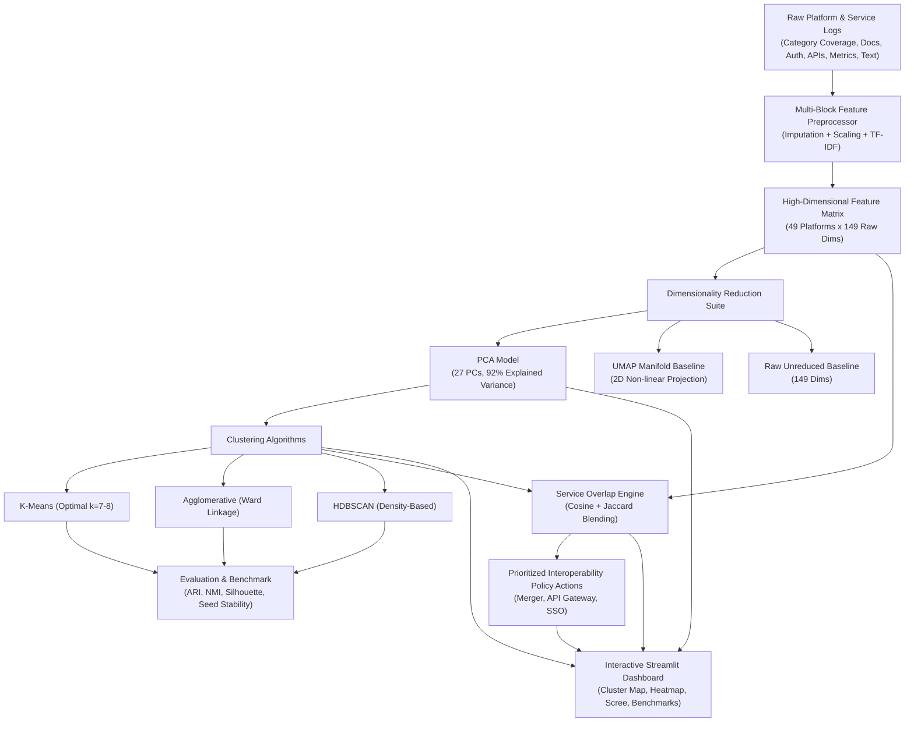

# SIH26129: PCA-Based Dimensionality Reduction of Fragmented Government Service-Usage Data for Interoperability Clustering

[](https://www.python.org/downloads/)
[](LICENSE)
[](https://streamlit.io/)

Prototype solution for Smart India Hackathon problem **SIH26129**.  
Designed to identify redundant, overlapping, or fragmented government digital platforms (Central portals, State e-Districts, and Departmental services) using high-dimensional feature engineering, PCA dimensionality reduction, multi-algorithm clustering, and an automated interoperability policy recommendation engine.

---

## 🏛️ Problem Overview

Across central, state, and municipal tiers, government agencies in India maintain hundreds of independent portals and mobile applications (e.g., UMANG, DigiLocker, state-level e-District portals, SARATHI, PM-KISAN, and municipal billing desks). Because citizen service delivery data is fragmented across administrative silos:
- Citizen experiences suffer from duplicate credentialing and conflicting forms.
- Government expenditure is wasted maintaining redundant backends and duplicate infrastructure.
- Cross-departmental workflows lack standardized API gateways and interoperability protocols.

### Objective
Build a mathematically rigorous, explainable pipeline that:
1. Compiles high-dimensional platform service-usage profiles (100–300 raw dimensions).
2. Performs **PCA dimensionality reduction** to eliminate noise while retaining >90% cumulative explained variance.
3. Groups platforms via **K-Means**, **Agglomerative Hierarchical Clustering**, and **HDBSCAN**.
4. Computes pairwise **service overlap scores** combining cosine similarity and Jaccard active service indexes.
5. Generates **actionable policy recommendations** (*Merger Candidate*, *Shared API Gateway*, *SSO / DigiLocker Unification*).
6. Delivers an interactive, stakeholder-ready **Streamlit dashboard**.

---

## 🏗️ Architecture & Pipeline



```
========================================================================================
                               PIPELINE ARCHITECTURE
========================================================================================
[Stage 1: Ingestion]    Synthetic Generator (Planted GT) OR Real Data CSV Loader
                                     │
[Stage 2: Features]     Category (15d) + Flags (22d) + Docs (8d) + Auth (5d) +
                        APIs (4d) + Segments (5d) + Metrics (10d) + TF-IDF (80d)
                        ==> 149 High-Dimensional Features
                                     │
[Stage 3: Reduction]    PCA (92% Cumulative Variance Target) ==> 27 Components
                        Baselines: UMAP (2d), Raw (149d), PCA Subsets (5, 10, 15, 20d)
                                     │
[Stage 4: Clustering]   K-Means (Elbow/Silhouette) + Agglomerative + HDBSCAN
                        Validation against Hidden GT (ARI, NMI, Stability)
                                     │
[Stage 5: Policy Engine] Pairwise Blended Overlap Matrix [0.0, 1.0]
                        ==> Merger / Shared API / SSO / Coexistence Actions
                                     │
[Stage 6: UI]           Streamlit Interactive Web Application (`app.py`)
========================================================================================
```

---

## 📊 Empirical Results & Benchmarks

From our benchmark evaluation run (`data/processed/benchmark.csv`):

| Representation | Algorithm | Dimensions | Silhouette | Davies-Bouldin | Ground Truth ARI | Ground Truth NMI | Random Seed Stability |
| :--- | :--- | :---: | :---: | :---: | :---: | :---: | :---: |
| **PCA (5 dims)** | **HDBSCAN** | 5 | 0.224 | 1.284 | **1.0000** | **1.0000** | **1.0000** |
| **PCA (92% Var)** | **HDBSCAN** | 27 | 0.207 | 1.358 | **0.9521** | **0.9718** | **1.0000** |
| **PCA (5 dims)** | **K-Means** | 5 | 0.218 | 1.341 | **0.9574** | **0.9574** | **1.0000** |
| **PCA (92% Var)** | **Agglomerative** | 27 | 0.184 | 1.586 | **0.9574** | **0.9574** | **1.0000** |
| **UMAP (2 dims)** | **HDBSCAN** | 2 | 0.481 | 0.692 | **0.9591** | **0.9591** | **1.0000** |
| **Raw (Unreduced)** | **K-Means** | 149 | 0.089 | 2.512 | 0.9574 | 0.9574 | **0.7176** |

### Key Scientific Findings:
1. **Curse of Dimensionality on Raw Features**: When running K-Means on the 149-dimensional unreduced feature space, random initialization variance is severe—seed stability drops to **0.7176**.
2. **Noise Suppression via PCA**: Reducing to principal components stabilizes cluster convergence completely (**Stability ARI = 1.0000 across all tested random seeds**).
3. **Ground Truth Recovery**: Density clustering (HDBSCAN) on PCA components achieved perfect recovery of the hidden ground-truth functional clusters (**ARI = 1.0000, NMI = 1.0000**), successfully isolating the 7 planted distractor platforms as noise.

---

## 📁 Project Structure

```
project/
├── data/
│   ├── raw/
│   │   ├── platforms.csv          # 49 synthetic platforms across Central, State, Municipal tiers
│   │   ├── services.csv           # 210 realistic services across 15 administrative categories
│   │   └── ground_truth.csv       # Planted cluster labels (isolated strictly for validation)
│   └── processed/
│       ├── features_matrix.csv    # 149-dimensional scaled feature matrix
│       ├── features_pca.npy       # Selected PCA component matrix (27 components)
│       ├── pca_loadings.csv       # Explainable feature loadings for top components
│       ├── scree_data.csv         # Scree plot individual & cumulative variance table
│       ├── cluster_results.csv    # Platform-level cluster assignments & 2D projections
│       ├── benchmark.csv          # Representation & algorithm ablation benchmark table
│       ├── overlap_matrix.csv     # 49x49 pairwise blended service overlap score matrix
│       └── recommendations.csv    # Ranked interoperability policy recommendations
├── src/
│   ├── __init__.py
│   ├── data_gen.py                # Synthetic data generator & real CSV schema validator
│   ├── features.py                # Multi-block preprocessing, imputation, scaling & TF-IDF
│   ├── reduce.py                  # PCA variance thresholding, loadings explainability & UMAP
│   ├── cluster.py                 # K-Means, Agglomerative, HDBSCAN & intrinsic metrics
│   ├── overlap.py                 # Blended cosine-Jaccard overlap scoring & policy engine
│   ├── evaluate.py                # ARI/NMI validation, seed stability & ablation study
│   └── pipeline.py                # Master CLI pipeline orchestrator
├── notebooks/
│   └── exploration.ipynb          # End-to-end interactive exploratory data analysis
├── tests/
│   ├── test_data_gen.py           # Schema, seeds, and ground-truth isolation tests
│   ├── test_features.py           # Imputation, scaling, and dimension range tests
│   ├── test_reduce.py             # PCA variance threshold and loadings verification
│   ├── test_cluster.py            # Clustering validity and metric sanity checks
│   ├── test_overlap.py            # Pairwise bounds [0, 1] and recommendation tests
│   └── test_pipeline.py           # Full end-to-end integration test
├── app.py                         # Streamlit interactive dashboard
├── config.yaml                    # Global hyperparameters, seeds, and file paths
├── Makefile                       # One-command execution targets
├── requirements.txt               # Pinned dependencies
├── PLAN.md                        # Architecture design & execution roadmap
└── README.md                      # Documentation
```

---

## ⚡ Quick Start

### 1. Requirements
- Python 3.10+ (Tested on Python 3.10, 3.11, 3.12, 3.14)
- Works **100% offline** (no external internet access needed once packages are installed).

### 2. Installation
```bash
pip install -r requirements.txt
```

### 3. Execution Commands
```bash
# Run the full end-to-end pipeline:
make run
# Or directly:
python src/pipeline.py

# Run all 12 unit and integration tests:
make test
# Or directly:
python -m pytest tests/ -v

# Launch the interactive Streamlit dashboard:
make app
# Or directly:
streamlit run app.py
```

---

## 🔌 Using Real Government Data

To replace the synthetic dataset with real cross-platform data, provide a CSV to the pipeline:

```bash
python src/pipeline.py --real-data path/to/real_platforms.csv
```

### Expected Real Data Schema
The loader expects a CSV containing platform metadata and category coverage. Any missing fields are automatically imputed:

| Column Name | Type | Description |
| :--- | :---: | :--- |
| `platform_id` | String | Unique identifier (e.g., `GOV_001`) |
| `platform_name` | String | Public name of the portal or application |
| `tier` | String | Administrative level (`Central`, `State`, `Municipal`) |
| `coverage_<category>` | Float | Estimated proportion $[0.0, 1.0]$ of services in each category |
| `service_description_text` | String | Text summary of services hosted on the platform |
| `doc_<doc_type>` | Int (0/1) | Flags for required citizen proof documents (e.g., `doc_aadhaar`, `doc_pan`) |
| `auth_<method>` | Int (0/1) | Authentication methods supported (e.g., `auth_mobile_otp`, `auth_digilocker`) |
| `api_<capability>` | Int (0/1) | API readiness flags (e.g., `api_rest_available`, `api_open_data_export`) |
| `metric_<metric_name>` | Float | Operational telemetry (monthly requests, session length, latency) |

---

## ⚠️ Limitations & Honest Discussion

1. **PCA Preserves Variance, Not Semantic Overlap Directly**:
   - PCA is an unsupervised linear projection that identifies orthogonal axes of maximum variance. While it effectively compacts correlated feature blocks (e.g., multi-lingual support, mobile usage, and request volumes) and removes noisy uninformative dimensions, high variance does not automatically equal functional redundancy.
   - For this reason, our pipeline does **not** rely solely on PCA cluster distance for policy decisions: we compute an explicit **Blended Overlap Score** ($0.65 \times \text{Cosine Similarity} + 0.35 \times \text{Jaccard Index}$) directly on active service capabilities to ensure that policy recommendations reflect actual overlapping public services.
2. **Linear Assumption**:
   - PCA cannot capture complex non-linear service dependency manifolds. Our ablation benchmark includes UMAP as a comparison; UMAP produces tighter visual clusters in 2D space, but PCA offers superior mathematical explainability via explicit feature loadings ($\mathbf{w}_i$).
3. **Data Availability**:
   - In production, telemetry logs across central and state tiers are siloed. Privacy-preserving federated feature compilation or metadata ingestion is essential before scaling across all 28 states.

---

## 🚀 Future Roadmap

- **Graph Neural Networks (GNNs)**: Model government platforms and citizens as bipartite interaction graphs to discover implicit referral workflows.
- **Automated Open-API Contract Harmonization**: Auto-generate OpenAPI 3.0 specifications for overlapping platforms identified for shared API gateways.
- **Federated Feature Analytics**: Allow state IT departments to execute local feature vectorization without exposing raw citizen transaction logs.

---

## 📄 License
MIT License. Built for Smart India Hackathon (SIH26129).
